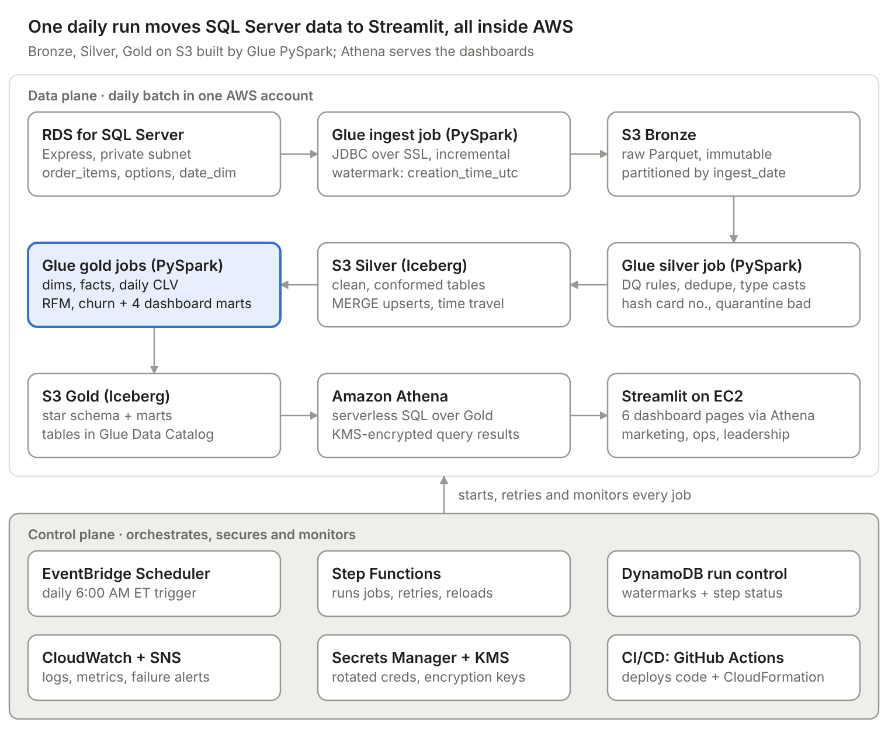

# GlobalPartners Solution Design — AWS PySpark Pipeline

**Author:** Peter · **Last updated:** 2026-10-23

## Executive summary

GlobalPartners gets a daily, fully AWS-native batch pipeline: Amazon RDS for SQL Server → AWS Glue (PySpark) → an S3 Bronze/Silver/Gold lake → Amazon Athena → Streamlit on EC2. Its core table is a daily customer CLV snapshot, so CLV can be read for any customer on any date.

**In scope**

- **Primary goal:** Customer Lifetime Value per customer, recalculated daily and stored as a history so its evolution is visible, tagged High (top 20%), Medium (mid 60%), Low (bottom 20%).
- **Secondary goals:** RFM segmentation, churn indicators, sales trends and seasonality, loyalty impact, location performance, discount effectiveness.
- **Production features:** scheduling, encryption at rest and in transit, retries, failure alerts, idempotent reloads and backfills, CI/CD from GitHub.

**Constraints honored**

- Every component is an AWS service or open-source; no new licenses (RDS SQL Server Express is license-included).
- No Snowflake, dbt or other external platforms.
- All transformation and metric logic runs in PySpark on AWS Glue.

**Source volumes:** order\_items 203,519 rows · order\_item\_options 193,017 rows · date\_dim 365 rows (2023 only, while orders span April 2020 to February 2024).

## Architecture



*Editable source: [architecture.drawio](architecture.drawio) (open in [diagrams.net](https://app.diagrams.net)) · vector: [architecture.svg](architecture.svg) · source data findings: [data_profile.md](data_profile.md)*

Data leaves SQL Server once per day and lands unchanged in Bronze; Silver and Gold can always be rebuilt from Bronze without touching the source. Streamlit never reads S3 directly: it queries Gold through Athena with a read-only IAM role.

## Tech stack and why

Each service was picked as the smallest serverless or managed AWS option that meets the requirement, so there is little to patch and cost scales to near zero between runs.

| Layer | Service | Why this one | Alternative rejected |
| --- | --- | --- | --- |
| Source | Amazon RDS for SQL Server Express | Managed SQL Server, license included, private subnet, automated backups | SQL Server on EC2: we would manage licensing, patching and backups |
| Ingestion | AWS Glue PySpark job + JDBC connection | Keeps ingestion in PySpark as required; serverless; native SQL Server JDBC; incremental pulls by watermark | AWS DMS: strong for CDC, but adds a service and non-PySpark logic for a \~400K-row daily batch |
| Storage | Amazon S3, Bronze / Silver / Gold | Cheap, 11-nines durable, decouples storage from compute; Bronze lets us replay without re-hitting SQL Server | Redshift: a warehouse cluster is overkill and costly at this volume |
| Table format | Apache Iceberg (native in Glue 5.0) | Open source, no license; ACID MERGE upserts, partition overwrite, time travel for safe reloads | Plain Parquet: no upserts, reloads risk partial writes |
| Transform | AWS Glue 5.0 (Spark 3.5) jobs | All metric logic in PySpark; serverless, per-second billing; auto-scaling workers | Amazon EMR: more cluster operations for no gain at this size |
| Catalog | AWS Glue Data Catalog | One schema registry shared by Glue, Athena and Streamlit; jobs register tables directly, no crawler cost | Hive metastore on EC2: more to run |
| Data quality | AWS Glue Data Quality (DQDL) + PySpark checks | Rules run inside the job; failed rows quarantined, results stored for audit | Great Expectations: works, but another library to maintain |
| Orchestration | AWS Step Functions + EventBridge Scheduler | Visual state machine, per-step retry/catch, re-run from failed step; pennies per month | Amazon MWAA (Airflow): roughly $350+/month minimum; Glue Workflows: weak error handling |
| Run control | Amazon DynamoDB table | Stores watermarks and per-step status for restarts | Glue job bookmarks alone: opaque, hard to rewind for reloads |
| Query | Amazon Athena | Serverless SQL over Gold; pay per data scanned; Streamlit queries it via boto3 / PyAthena | Keeping an RDS reporting copy: duplicate storage and loads |
| Visualization | Streamlit on Amazon EC2 (t3.small) | Required tool; one small instance with an IAM role, no stored keys | ECS Fargate or App Runner: more setup for one internal app |
| Security | AWS KMS, Secrets Manager, IAM, VPC endpoints | Encryption keys, rotated DB credentials, least-privilege roles, private traffic | Credentials in code or config: rejected |
| Monitoring | Amazon CloudWatch + Amazon SNS | Job logs, metrics, alarms, email alerts on failure | Third-party monitoring: new license |
| CI/CD and IaC | GitHub Actions + AWS CloudFormation | Required GitHub CI/CD; OIDC role into AWS (no access keys); repeatable environments | Manual console setup: not reproducible |

## Data model

The Gold layer is a star schema plus one daily periodic snapshot, fact\_customer\_clv\_daily, which answers the primary question: CLV for every customer on every date since their first order.

The source has no customer or location tables, so dim\_customer is derived from user\_id and dim\_restaurant from restaurant\_id.

**Join keys:** order\_items → order\_item\_options on (order\_id, lineitem\_id) · order\_items → date\_dim on to\_date(creation\_time\_utc) = date\_key.

| Table | Layer | Grain | Key columns | Feeds |
| --- | --- | --- | --- | --- |
| dim\_date | Gold | One row per calendar date, generated in PySpark from the first to the last order date (source date\_dim covers 2023 only; its holiday names are kept, US federal holidays derived for other years) | date\_sk (yyyymmdd), date\_key, day\_of\_week, week, month, quarter, year, is\_weekend, is\_holiday, holiday\_name | All time-based views |
| dim\_customer | Gold, SCD Type 2 | One row per user\_id per loyalty-status version | customer\_sk, user\_id, card\_hash (SHA-256 of printed\_card\_number), is\_loyalty, first\_order\_date, valid\_from, valid\_to, is\_current | Segmentation, loyalty |
| dim\_restaurant | Gold | One row per restaurant\_id | restaurant\_sk, restaurant\_id, first\_order\_date, last\_order\_date | Location performance |
| dim\_item | Gold | One row per item\_name + item\_category | item\_sk, item\_name, item\_category | Category trends |
| dim\_channel | Gold | One row per app\_name | channel\_sk, app\_name | Channel filters |
| fact\_order\_line | Gold | One row per order line (order\_id, lineitem\_id) | date\_sk, hour\_utc, customer\_sk, restaurant\_sk, item\_sk, channel\_sk, item\_quantity, unit\_price, list\_price, item\_line\_amount, item\_gross, item\_discount\_amt, option\_addon\_amt, line\_net\_revenue, is\_discounted | Category and discount analysis |
| fact\_order | Gold | One row per order\_id | order\_ts\_utc, date\_sk, customer\_sk, restaurant\_sk, channel\_sk, is\_loyalty, line\_count, gross\_revenue, discount\_amt, net\_revenue, has\_discount | Trends, AOV, location, loyalty |
| **fact\_customer\_clv\_daily** | Gold, periodic snapshot | One row per customer per date, from first order to run date | snapshot\_date, customer\_sk, user\_id, revenue\_on\_day, orders\_to\_date, clv\_to\_date, aov\_to\_date, first\_order\_date, last\_order\_date, days\_since\_last\_order, avg\_gap\_days, spend\_change\_pct, clv\_percentile, clv\_tier, r\_score, f\_score, m\_score, rfm\_segment, churn\_status | **Primary: CLV evolution**, segmentation, churn |
| mart\_sales\_daily | Gold mart | Date × restaurant × category × channel × daypart | orders, items, gross, discount, net revenue | Sales trends dashboard |
| mart\_loyalty\_monthly | Gold mart | Month × loyalty flag | customers, orders, AOV, repeat rate, avg CLV | Loyalty dashboard |
| mart\_location\_monthly | Gold mart | Month × restaurant | revenue, AOV, orders per day, 30-day retention, revenue rank | Location dashboard |
| mart\_discount\_monthly | Gold mart | Month × restaurant × discounted flag | orders, gross, discount, net, avg discount per order | Pricing and discount dashboard |

**Why a daily snapshot for CLV:** a single "current CLV" column loses history. Storing one row per customer per day (partitioned by snapshot month, Iceberg) lets the dashboard draw any customer's CLV curve and track tier movement over time. Rows begin at each customer's first order, so inactive pre-history is not stored. If volume grows, the fallback is a change-only table joined to dim\_date at query time.

**Bronze and Silver:** Bronze keeps raw extracts as Parquet partitioned by ingest\_date, never modified. Silver holds typed, de-duplicated, conformed copies of the three source tables (silver.order\_items, silver.order\_item\_options, silver.date\_dim) with card numbers hashed and bad rows moved to a quarantine table.

## Metric logic (PySpark)

Revenue is computed once at line level in fact\_order\_line, and every metric reads from it, so all dashboards agree on one number.

```math
\text{line\_net} = \text{item\_price} + \sum (\text{option\_price} \times \text{option\_quantity})
```

Source item\_price is the line total (price × quantity), not a unit price: 9,873 of 13,496 multi-quantity lines equal unit price × quantity. So unit\_price = item\_price ÷ item\_quantity and item\_line\_amount = item\_price. Gross = list\_price × item\_quantity on discounted lines (otherwise item\_line\_amount) plus option charges; net = item\_line\_amount + option charges; discount = gross − net. Option prices are never negative in this data (0.00 to 8.00), so options are add-on revenue only.

| Metric | Definition | Thresholds (configurable) |
| --- | --- | --- |
| CLV to date | Cumulative net revenue per customer up to snapshot\_date | — |
| CLV tier | percent\_rank of clv\_to\_date across all customers on that snapshot\_date | High ≥ 0.80 · Medium 0.20–0.80 · Low < 0.20 |
| Recency (R) | Days from last order to snapshot\_date | Scored 1–5 by quintile, 5 = most recent; R, F, M are ranked only among customers with an order in the last N months, everyone else scores 1 |
| Frequency (F) | Distinct orders in the last N months | N = 6; scored 1–5 |
| Monetary (M) | Net spend in the last N months | N = 6; scored 1–5 |
| RFM segment | Rules on R, F, M scores | VIP: R, F, M ≥ 4 · New: F ≤ 2 and R ≥ 4 and first order ≤ 30 days ago · Churn risk: R ≤ 2 and F ≤ 2 · everyone else: Regular |
| Average gap | (last\_order\_date − first\_order\_date) ÷ (orders\_to\_date − 1) | Null for one-time buyers |
| Spend change % | Net spend last 30 days vs prior 30 days | — |
| Churn status | Days since last order | Active ≤ 30 · Cooling 31–45 · At risk 46–90 · Lapsed > 90; also At risk when days since last order > 2 × average gap |
| Sales trends | Net revenue and orders by day, week, month; by restaurant, category, channel, daypart | Dayparts (local time): Breakfast < 11 · Lunch 11–14 · Afternoon 14–17 · Dinner 17–21 · Late ≥ 21 |
| Loyalty impact | Members vs non-members: avg spend per customer, AOV, repeat rate (share with ≥ 2 orders), avg CLV | Member = is\_loyalty on the customer's current SCD row |
| Location ranking | Revenue, AOV, orders per day, 30-day repeat rate per restaurant per month | dense\_rank by revenue; top and bottom 5 flagged |
| Discount effectiveness | Discounted line = unit price at least $0.05 below its usual menu price (list price rule below); discounted order = any discounted line. Compare gross, discount, net and order counts for discounted vs full-price orders; orders per customer in the 30 days before vs after their first discounted order | — |

**List price (usual menu price) rule:** list\_price is the most common unit\_price for the same restaurant, item and calendar month; when that group has fewer than 5 lines, the most common price for the restaurant and item across all months is used; ties take the higher price. Using restaurant and month keeps menu price increases and location pricing from showing up as discounts. On the source data this flags 13,755 lines (6.8%) in 12,530 orders (9.6%), about $22,700 of discount, against $1.88M gross revenue. Counts exclude the development channel and price outliers.

**Daily CLV snapshot, core logic** (backfill mode builds every date; daily mode appends only run\_date from yesterday's snapshot plus today's orders):

```python
from pyspark.sql import functions as F, Window as W

orders = spark.table("gold.fact_order")
daily = (orders.groupBy("user_id", F.to_date("order_ts_utc").alias("d"))
         .agg(F.sum("net_revenue").alias("rev_day"),
              F.countDistinct("order_id").alias("orders_day")))

first = daily.groupBy("user_id").agg(F.min("d").alias("first_d"))
spine = spark.table("gold.dim_date").select(F.col("date_key").alias("d"))
grid = (first.join(spine, (spine.d >= first.first_d) & (spine.d <= F.lit(run_date))))

cum = W.partitionBy("user_id").orderBy("d").rowsBetween(W.unboundedPreceding, 0)
clv = (grid.join(daily, ["user_id", "d"], "left")
       .fillna(0, ["rev_day", "orders_day"])
       .withColumn("clv_to_date", F.sum("rev_day").over(cum))
       .withColumn("orders_to_date", F.sum("orders_day").over(cum))
       .withColumn("last_order_d",
                   F.last(F.when(F.col("orders_day") > 0, F.col("d")), ignorenulls=True).over(cum))
       .withColumn("days_since_last_order", F.datediff("d", "last_order_d")))

by_day = W.partitionBy("d").orderBy("clv_to_date")
clv = (clv.withColumn("clv_percentile", F.percent_rank().over(by_day))
          .withColumn("clv_tier",
                      F.when(F.col("clv_percentile") >= 0.8, "High")
                       .when(F.col("clv_percentile") < 0.2, "Low")
                       .otherwise("Medium")))
```

CLV here is historical (actual spend to date), as the requirements define it. A predictive CLV (AOV × purchase frequency × expected lifespan) can be added later as a column without changing the model.

## Data quality checks

Checks run in the Silver job between Bronze and Silver; a blocking failure stops the run before any Gold table changes, and row-level failures go to a quarantine table instead of being dropped.

| Check | Table | Rule | On failure |
| --- | --- | --- | --- |
| Row count reconciliation | All 3 | Bronze count = SQL Server SELECT COUNT(\*) for the same window | Block run, alert |
| Primary key unique | order\_items | (order\_id, lineitem\_id) unique | Keep latest, log duplicates |
| Required keys present | order\_items | order\_id, lineitem\_id, user\_id, restaurant\_id, creation\_time\_utc not null | Quarantine row |
| Valid timestamp | order\_items | creation\_time\_utc parses and is not in the future | Quarantine row |
| Valid amounts | order\_items | item\_price ≥ 0, item\_quantity > 0 | Quarantine row |
| Orphan options | order\_item\_options | Every (order\_id, lineitem\_id) exists in order\_items | Quarantine row |
| Option quantity | order\_item\_options | option\_quantity > 0 | Quarantine row |
| Single currency | order\_items | currency = 'USD' | Warn; exclude from revenue until FX rule agreed |
| Calendar coverage | date\_dim | Every order date has a dim\_date row | Block run, alert |
| Boolean domain | order\_items, date\_dim | is\_loyalty, is\_weekend, is\_holiday in (true, false) | Cast; quarantine unknowns |
| Quarantine threshold | All | Quarantined rows < 1% of batch | Block run above 1%, alert |

DQ results (rule, pass/fail, row counts, run\_id) are written to an Iceberg audit table so the SME can see data health over time.

## Orchestration, scheduling and failure reload

EventBridge Scheduler starts one Step Functions run every day at 6:00 AM America/New\_York; every step is idempotent for its run\_date, so any failed day can be re-run safely without duplicates.

**Daily run (Step Functions states)**

1. **Start:** read run\_date (default: yesterday) and mode (daily / reload / backfill); write RUNNING to the DynamoDB run-control table.
2. **Ingest (parallel Map, 3 branches):** Glue job pulls each table from RDS where creation\_time\_utc > last watermark − 3 days (catches late rows), writes Bronze partition ingest\_date=run\_date.
3. **Silver:** DQ rules, type casts, de-duplication, card hashing; MERGE into Silver Iceberg tables.
4. **Gold dimensions:** dim\_date, dim\_customer (SCD2), dim\_restaurant, dim\_item, dim\_channel.
5. **Gold facts:** fact\_order\_line, fact\_order (MERGE on keys).
6. **CLV snapshot:** write partition snapshot\_date=run\_date of fact\_customer\_clv\_daily.
7. **Marts:** overwrite affected months of the four marts.
8. **Finish:** advance watermark, write SUCCEEDED, SNS success summary.

**Failure handling**

| Mechanism | How it works |
| --- | --- |
| Automatic retry | Each Glue task: 2 retries, 5-minute interval, backoff × 2, on Glue.ConcurrentRunsExceededException and job failure |
| Alert | Catch on every state → write FAILED + step name to DynamoDB → SNS email with run\_id, step and CloudWatch log link |
| Resume from failed step | Re-running with the same run\_date reads DynamoDB and skips steps already SUCCEEDED |
| Manual reload | Start the state machine with {"run\_date": "2026-10-20", "mode": "reload"}; Gold partitions for that date are overwritten, never appended |
| Replay without source | Silver and Gold can be rebuilt from Bronze if SQL Server is unavailable; Bronze is immutable |
| Backfill | mode = backfill with a date range; a Map state runs dates in order, max concurrency 1 for the CLV step |
| Bad write rollback | Iceberg time travel: roll a table back to its previous snapshot with one Spark procedure call |
| Watermark safety | Watermark advances only after the whole run succeeds |
| Timeouts | Each Glue job has a timeout (e.g. 30 min); CloudWatch alarm if the run has not finished by 8:00 AM ET |

## Security and encryption

Data is encrypted at rest with one customer-managed KMS key and in transit with TLS everywhere; no credentials live in code.

| Control | Implementation |
| --- | --- |
| Encryption at rest | SSE-KMS (customer-managed key, bucket keys on) for all S3 buckets; RDS storage encryption; Glue security configuration encrypts job output, CloudWatch logs and bookmarks; Athena results encrypted with SSE-KMS; DynamoDB encrypted |
| Encryption in transit | RDS parameter rds.force\_ssl = 1 and JDBC encrypt=true; S3 bucket policy denies aws:SecureTransport = false; Streamlit served over HTTPS |
| Credentials | SQL Server login stored in Secrets Manager with rotation; Glue connection reads the secret at runtime |
| Network | RDS in private subnets, not publicly accessible; Glue runs in the same VPC; S3 gateway endpoint and Secrets Manager / Glue / KMS interface endpoints keep traffic off the internet |
| Least privilege | Separate IAM roles: Glue ingest (RDS secret + Bronze write), Glue transform (Bronze read, Silver/Gold write), Streamlit EC2 (Athena + Gold read only), GitHub deploy role via OIDC |
| PII | printed\_card\_number hashed (SHA-256 with salt from Secrets Manager) in Silver; raw value stays only in encrypted Bronze with restricted access |
| Streamlit host | IMDSv2 only, no SSH (Session Manager), security group open only to the company IP range, Streamlit login (st.login or Cognito) |
| Audit | CloudTrail on, S3 server access logs, Glue DQ audit table, S3 versioning on Bronze |

## Streamlit dashboards

One Streamlit app with six pages; each page reads one Gold table through Athena, cached for an hour with st.cache\_data so the daily data costs a few cents to serve.

| Page | Business question | Gold source | Key visuals | Filters |
| --- | --- | --- | --- | --- |
| Customer segmentation | Which segments emerge by spend, frequency, recency and loyalty? | fact\_customer\_clv\_daily (latest date) | RFM segment counts and revenue share; R × F heatmap; CLV tier mix by loyalty; one customer's CLV curve over time | Snapshot date, loyalty, restaurant |
| Churn risk indicators | Which signals mark rising churn risk? | fact\_customer\_clv\_daily | Churn status counts and trend; days-since-last-order distribution; at-risk customer table with avg gap and spend change, downloadable as CSV | Status, CLV tier, threshold slider |
| Sales trends and seasonality | How do sales move by month, season and holiday? | mart\_sales\_daily + dim\_date | Daily / weekly / monthly revenue line; holiday markers; category and location breakdown; daypart × weekday heatmap | Date range, grain, category, restaurant |
| Loyalty program impact | Do members spend more and come back more? | mart\_loyalty\_monthly | Member vs non-member: AOV, repeat rate, avg CLV, spend per customer, side by side and over time | Month range, channel |
| Location performance | Which locations lead and what sets them apart? | mart\_location\_monthly | Revenue ranking bars (top and bottom 5 highlighted); AOV vs orders-per-day scatter; repeat-rate column | Month, metric to rank by |
| Pricing and discounts | How do discounts affect volume and net revenue? | mart\_discount\_monthly | Gross vs discount vs net for discounted and full-price orders; discount share and average % off over time; most-discounted items; before/after order frequency | Month range, restaurant |

## CI/CD, repository and cost

GitHub Actions tests every pull request and deploys main to AWS through an OIDC role, so no AWS keys are stored in GitHub.

**Pipeline**

1. **Pull request:** ruff lint, pytest on PySpark transforms with local Spark and small fixture CSVs, cfn-lint on templates, Step Functions definition validation.
2. **Merge to main → dev:** upload Glue scripts and a shared-library wheel to the artifacts bucket; deploy CloudFormation stacks; run the state machine once on a sample date as a smoke test.
3. **Release → prod:** same steps behind a GitHub Environment approval; Streamlit updated on EC2 via SSM Run Command (git pull, pip install, systemctl restart).

**Repository layout**

```text
globalpartners-pipeline/
├── .github/workflows/        ci.yml, deploy.yml
├── infra/                    CloudFormation: network, storage-kms, rds, glue, stepfunctions, streamlit-ec2, monitoring
├── sql_server/               01_create_tables.sql, 02_load_from_s3.sql (BULK INSERT)
├── glue_jobs/
│   ├── ingest_sqlserver.py
│   ├── silver_transform.py
│   ├── gold_dimensions.py
│   ├── gold_facts.py
│   ├── gold_clv_snapshot.py
│   └── gold_marts.py
├── lib/gp_common/            config, logging, dq_rules, iceberg helpers
├── config/                   thresholds.yaml (RFM N, churn days, tier cut-offs), dq_rules.dqdl
├── orchestration/            state_machine.asl.json
├── streamlit_app/            app.py, pages/, athena_client.py
├── tests/                    unit/, fixtures/
└── docs/                     solution_design.md, data_profile.md, architecture.drawio/.svg/.png
```

**Estimated monthly cost (approximate, us-east-1 list prices; confirm in AWS Pricing Calculator)**

| Item | Assumption | Approx. USD / month |
| --- | --- | --- |
| AWS Glue | 6 jobs × 2 DPU × \~4 min daily at $0.44 per DPU-hour | \~$11 |
| RDS SQL Server Express | db.t3.micro, 20 GB, single-AZ, running 24/7 | \~$20–30 (less if stopped outside runs) |
| EC2 for Streamlit | t3.small on demand | \~$15 |
| S3, Athena, Step Functions, DynamoDB, SNS | Under 1 GB data, light querying | < $3 |
| KMS + Secrets Manager | 1 key + 2 secrets | \~$2 |
| VPC interface endpoints | 3 endpoints, 1 AZ | \~$22 (or a NAT instance instead) |
| **Total** |  | **\~$75–85** |

## Assumptions

- option\_price is per option unit and applies once per order line (not multiplied by item\_quantity).
- restaurant\_id is the location; no store attributes (city, size) are available.
- One currency (USD) across all orders.
- creation\_time\_utc is converted to US Eastern for dates and dayparts until store time zones are provided.
- Daily batch latency (data as of yesterday) meets the business need; real-time is out of scope.
